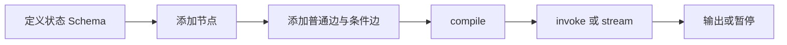

# 01｜体系定位与运行机制

## 1. LangGraph 解决什么问题

普通脚本可以顺序调用几个函数。流程出现循环、多分支、人工介入、故障恢复、跨轮状态时，手写调用逻辑会逐渐难以追踪。

LangGraph 提供图编排与运行时：把工作拆成节点，通过边控制执行，通过状态传递数据，按需增加检查点、流式事件和恢复能力。它可以编排普通函数，也可以编排模型调用。见 [官方概览](https://docs.langchain.com/oss/python/langgraph/overview)。

例子：用户问知识库问题，检索后证据不足，需要改写一次；仍不足则拒答；找到证据则生成，再检查引用。这是一个有界循环，而不是固定的三步调用。

## 2. 与相邻技术的关系

| 名称 | 主要职责 | 示例 |
|---|---|---|
| LLM | 理解、生成、提出工具调用 | 生成回答或检索查询 |
| LangChain | 模型、工具及高层 Agent 等抽象与集成 | 统一消息和工具接口 |
| LangGraph | 状态与控制流编排、恢复 | 检索失败后再检索 |
| LangSmith | 追踪、评测与部署等平台能力 | 查看一次运行的轨迹 |
| RAG | 根据检索证据生成回答的方法 | 公司知识库问答 |

LangGraph 不等于 RAG；RAG 不必使用 LangGraph。LangGraph 的节点也不要求使用完整 `langchain` 包。教程使用 `langchain-core` 的消息和工具类型，它会作为依赖安装。

## 3. 四个构件

```text
State：当前拥有的数据
Node：读取数据，执行工作，返回更新
Edge：决定下一步工作
Compiled graph：编译后可 invoke / stream 的运行对象
```

例：

```text
state = {question, query, documents, attempts, answer}
retrieve(state) → {documents: [...]}
check(state) → 根据证据决定 answer / rewrite / refuse
```

节点返回的是字段更新，不必返回所有旧字段。

## 4. 图的生命周期



`compile()` 检查图结构并绑定运行配置；不会预先替你调用模型，也不会训练一个新模型。

`START` 和 `END` 是特殊边界标识，不是你需要实现的业务函数。路由到 END 表示相应路径结束；若还有别的并行任务，整个运行不一定立刻停止。

## 5. Super-step：一轮执行的边界

用简单图理解：

```text
        ┌→ B ─┐
A ──────┤     ├→ D
        └→ C ─┘
```

如果 B、C 由 A 同时激活且只有一层，则可以在同一个 super-step 工作。B 不会因为运行得慢，就自动看到 C 刚返回的更新；它们基于这一轮的可见状态执行，更新在边界被合并。

顺序的 A→B→D 则跨多个步骤。这解释了为什么并行写同一个普通字段会冲突，以及为什么 reducer 很重要。执行模型参考 [Graph API](https://docs.langchain.com/oss/python/langgraph/graph-api)。

不要把 super-step 数等同于节点调用次数：一轮可有多个并行节点。

## 6. Workflow 与 Agent

固定工作流：程序控制下一步。例如“先查权限，再检索，再回答”。

Agent 流程：模型在约束范围内决定下一步。例如模型选择调用哪个搜索工具，收到结果后再决定是否继续。

二者可以组合：外围工作流强制权限校验，内部 Agent 负责探索证据。授权规则和最大轮数仍由程序控制。

## 7. 什么情况下值得引入图

适合：有条件分支、需持久化人工审批、有反馈循环、需恢复长任务、需汇总并行结果。

如果工作只是“一次输入→一次模型请求→一次输出”，普通函数可能已经足够。先画出流程，只有实际需要的节点和分支才进入图。

## 8. 设计前写清楚

1. 最终交付什么：答案、分类结果、待审批方案？
2. 哪些信息必须共享：问题、证据、预算、状态？
3. 哪些步骤可能失败或重复？
4. 哪些条件必须退出？
5. 哪些操作有真实副作用？

本教程的审批示例仅记录“允许继续”的结果，不会真实发送消息或发布内容。RAG 示例默认抽取展示证据，可选连接本地聊天模型。
