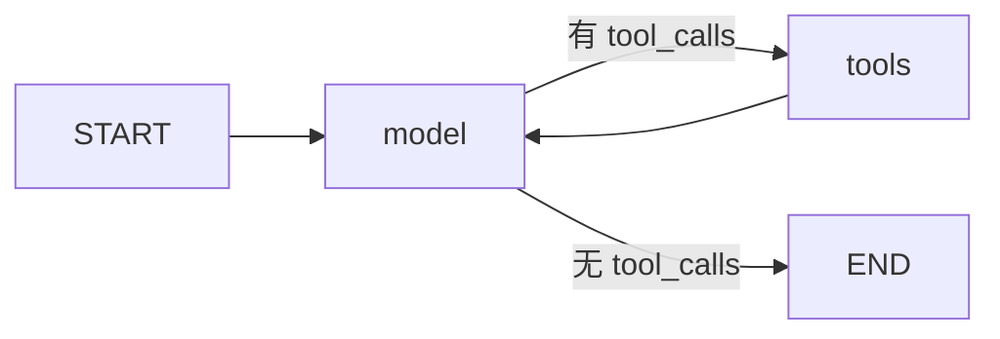

# 05｜消息、模型、工具与 Agent 循环

## 1. 消息不是普通字符串列表

典型消息类型：

| 类型 | 含义 |
|---|---|
| HumanMessage | 用户输入 |
| AIMessage | 模型回答，可能附带 tool_calls |
| ToolMessage | 某一次工具调用的结果 |
| SystemMessage | 给模型的任务与行为规则 |

示例使用 `langchain_core.messages` 导入这些类型。模型协议中既有文本，也有调用标识、参数、工具名等结构化内容。

## 2. MessagesState 与 add_messages

```python
from langgraph.graph import MessagesState
```

MessagesState 提供带消息合并逻辑的 messages 字段。常用的 `add_messages` 不只是列表拼接：已有相同消息 ID 时，可以更新对应消息；新 ID 则加入列表。

因此不能用普通列表加法替代所有消息管理需求。修改或删除历史消息时，要使用匹配当前版本的消息 ID 与删除机制，避免留下孤立工具结果。

官方说明：[消息状态](https://docs.langchain.com/oss/python/langgraph/graph-api-state)。

## 3. 一次工具调用包含什么

```python
from langchain_core.messages import AIMessage, ToolMessage

request = AIMessage(
    content="",
    tool_calls=[{
        "name": "double_number",
        "args": {"value": 6},
        "id": "call_1",
        "type": "tool_call",
    }],
)
response = ToolMessage(content="12", tool_call_id="call_1")
```

`tool_call_id` 将结果绑定到具体请求。不能把一个普通 HumanMessage 当作工具结果随便塞回去。

模型提出工具调用不等于工具已经执行。实际执行发生在程序侧。

## 4. 工具如何声明

```python
from langchain_core.tools import tool

@tool
def double_number(value: int) -> int:
    """返回整数 value 的两倍。"""
    return value * 2
```

名称、参数类型和说明共同帮助模型理解何时使用工具。真实工具还应校验业务限制，例如最大查询范围、允许的资源、只读权限。

不要提供一个不受约束的 `eval` 或任意命令执行工具来演示计算器，简单类型化函数已经足够。

## 5. Agent 的最小循环



model 读当前消息，返回一条 AIMessage。tools 执行调用，返回 ToolMessage。模型继续读取结果，最终产生普通回答。

LangGraph 提供 `ToolNode` 和 `tools_condition` 等组件。教程的 [tool_agent.py](示例项目/tool_agent.py) 使用实际 ToolNode，但 model 节点是确定性模拟函数：输入整数，提出翻倍调用，收到工具结果后结束。

这个例子验证的是消息协议与工具闭环，不是模型理解自然语言的能力。运行：

```bash
python tool_agent.py 6
```

应看到 HumanMessage→带 tool_calls 的 AIMessage→ToolMessage→最终 AIMessage，结果为 12。

## 6. 换成真实模型时改哪里

把模拟 model 节点换成支持工具调用的聊天模型：

```python
# 接口示意：model 的创建和依赖由实际供应商决定。
bound_model = model.bind_tools([double_number])

def model_node(state):
    reply = bound_model.invoke(state["messages"])
    return {"messages": [reply]}
```

这段不是完整独立程序。模型必须支持对应工具协议，不能只因它能聊天就假设 `bind_tools` 有效。

参考：[官方计算器 Quickstart](https://docs.langchain.com/oss/python/langgraph/quickstart)。

## 7. 必须控制工具预算

真实模型可能重复调用同一工具。可记录 model_calls、tool_calls、累计时间与成本，并设定明确上限。

若已经生成了工具请求，应按模型协议补齐结果或安全终止整次任务；不要删除一半消息后继续向模型提交不完整序列。

节点失败可以用重试；模型判断后主动再调用一次属于业务循环。二者分别计数，不要混成一个“重试次数”。

## 8. 何时不使用自由 Agent

退款申请、修改账户、发消息等动作，可以用确定性外层图强制检查与审批。让模型决定文案和建议，不让它绕过程序定义的授权条件。

后面的审批图会演示暂停与恢复，但只生成演示结果，不实际执行外部操作。
