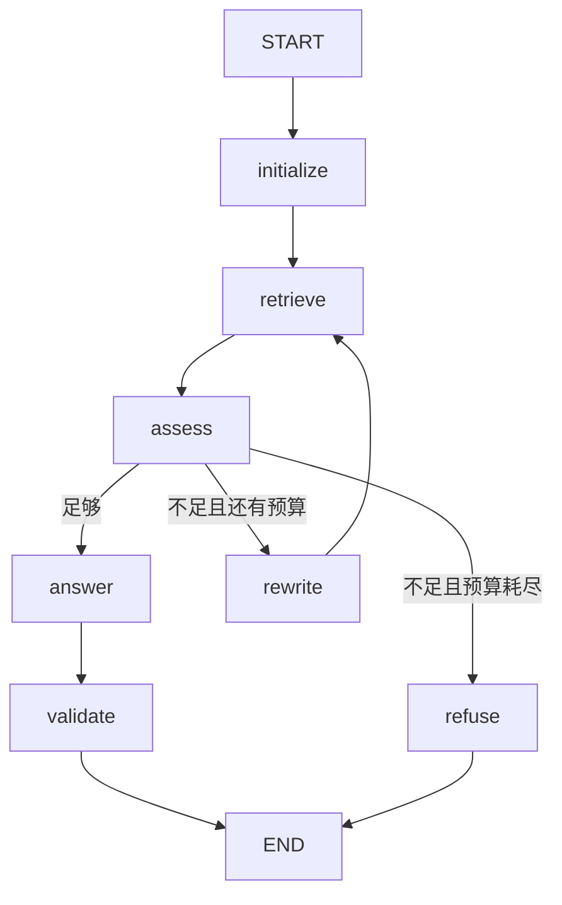

# 13｜LangGraph 与 RAG 完整实战

## 1. 这次增加的是编排能力

前一套 [RAG 教程](../RAG教程/00_阅读指南与学习路线.md) 关注文档切分、检索、生成和评测。本章把这些步骤放入图中，增加可观察的重试路径、终止条件与状态管理。

LangGraph 不会自动提高 Embedding 质量，也不会自动证明答案受证据支持。检索算法与证据充分性仍需独立验证。

## 2. 完整结构



每个节点对应一个可观察决策。临时连接失败在 retrieve 节点内部按 RetryPolicy 重试；无证据则沿 rewrite 边进入下一业务轮，两者不同。

## 3. 文件与职责

| 文件/函数 | 职责 |
|---|---|
| `knowledge.json` | 4 条虚构平台知识 |
| `keyword_retrieve` | 人工主题词子串匹配基线 |
| `build_rag_graph` | 创建节点与路由，支持注入检索器和生成器 |
| `extract_answer` | 直接展示证据，明确没有模型生成 |
| `ollama_answer` | 可选本地模型生成 |
| `test_examples.py` | 测试路径、预算、重试与状态重置 |

完整代码：[rag_workflow.py](示例项目/rag_workflow.py)。

## 4. 先运行没有模型的三个路径

```bash
python rag_workflow.py '退款多久到账' --stream
python rag_workflow.py '买完想退掉' --stream
python rag_workflow.py '年度专业版多少钱' --stream
```

预期节点路径：

```text
直接命中：initialize → retrieve → assess → answer → validate
改写命中：initialize → retrieve → assess → rewrite → retrieve → assess → answer → validate
最终拒答：initialize → retrieve → assess → rewrite → retrieve → assess → refuse
```

第二个问题通过固定规则把“退掉”改成“退款”，因此第二次命中。第三个问题即使命中专业版文档，也因年度价格缺失规则拒答。

默认输出是证据摘录，不是 LLM 生成答案。目的是先验证图的行为，再接入不确定的模型输出。

## 5. 状态字段

| 字段 | 含义 |
|---|---|
| question | 用户原问题，生成时仍使用它 |
| query | 当前检索查询，可以改写 |
| documents | 当前轮候选 |
| attempts | 成功完成的检索轮数 |
| max_attempts | 最多检索轮数，包含初次 |
| sufficient | 教学规则判断结果 |
| answer / sources | 输出与来源身份 |
| warnings | 引用格式检查结果 |
| status | running / answered / refused |

query 与 question 分开保存，避免改写时偷偷改变用户意图。initialize 重置当前请求相关字段，防止复用 thread 时误用上一轮资料。

## 6. 明确两处教学简化

**检索器简化。**它只匹配人工列出的主题词，既不是 BM25，也不是向量搜索。没有分页、权限过滤、全文切分和索引更新。

**充分性判断简化。**大多数问题只检查是否有候选，对“年度/年费”采用固定拒答规则。它无法普遍识别多条件缺失、冲突或证据与问题不匹配。

把这两处替换成真实实现时，应同步替换和评测充分性规则。不能接入年度价格文档后仍保留“所有年度问题一律拒答”的测试策略。

## 7. 注入前一套 RAG 的 BM25 检索器

先在 RAG 示例项目建立 `index_bm25.json`。然后可在当前示例项目保存并运行以下适配程序：

```python
from pathlib import Path
import sys
from rag_workflow import build_rag_graph

rag_dir = Path(__file__).resolve().parents[2] / "RAG教程" / "示例项目"
sys.path.insert(0, str(rag_dir))
from rag import Retriever

retriever = Retriever.from_file(rag_dir / "index_bm25.json")

def retrieve(query):
    hits = retriever.search(query, mode="bm25", top_k=3)
    return [{"id": h["id"], "text": h["text"], "source": h["source"]} for h in hits]

graph = build_rag_graph(retriever=retrieve)
print(graph.invoke({"question": "退款多久到账"})["answer"])
```

这段依赖两套教程保持同级目录，以及前一项目已建库。主项目本身独立运行，不强制依赖前一教程。

替换后更要注意：BM25 可能返回只有普通字词重合的噪声，`documents 非空` 不能证明充分。

## 8. 可选接入本地生成

准备 Ollama 并下载模型后：

```bash
ollama pull qwen2.5:3b
python rag_workflow.py '退款申请需要什么条件' --backend ollama
```

生成器通过 `/api/chat` 请求本地模型；若服务不可用会明确报错，不把连接失败伪装成知识缺失。接口参考 [Ollama Chat API](https://docs.ollama.com/api/chat)。

本次没有下载或运行该模型，真实回答质量与资源需求需要你在本机评测。extract 模式和图的恢复行为已实际测试。

## 9. 引用校验的范围

validate 检查回答中 `[1]` 等编号是否属于当前证据集合，也提示缺失引用。它不检查每句事实是否被来源支持。

当前 warnings 只是提示，状态仍可能是 answered。正式场景可添加 repair 或人工复核分支，并限制修复次数；不能一旦失败就无限生成。

## 10. 如何增加人工复核

当规则冲突、涉及外部操作或需要审核时，可以将 answer→validate 后的部分改为 review→finalize。审核 payload 应包含问题、草稿、实际证据与版本，而不是只问“是否继续”。

图必须配置持久化并绑定稳定 thread。审批通过不代表自动执行任何外部动作；执行节点还应遵守权限和幂等规则。

## 11. 评测同时看路径与内容

路径指标：调用次数、最大轮数是否遵守、失败后能否恢复、拒答路径是否正确、是否发生循环。

内容指标：检索证据覆盖、事实正确性、引用准确性、无答案拒答率。路径完全正确时，模型仍可能答错；答案碰巧正确时，图也可能浪费了大量重复调用。
